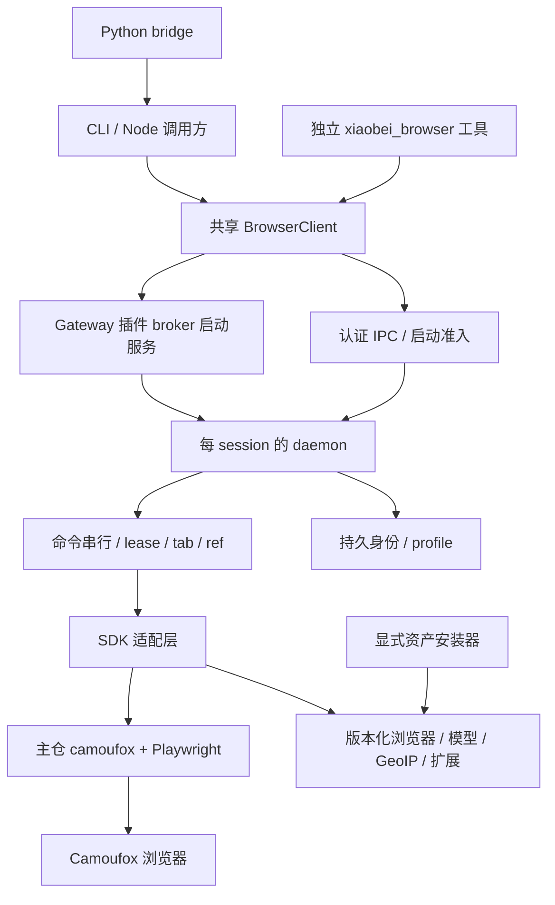

# 小贝浏览器开发指南

更新：2026-10-18。本文合并浏览器架构、5.8 升级交接和 WiseFlow 4 / OSBI 信息提取方案，作为后续浏览器开发的唯一设计入口。`browser/README.md` 只保留构建/调用方法；具体平台的登录、搜索和 profile 恢复仍按各技能及专项操作说明执行。

**当前范围：5.8 是破坏性升级，采用主仓 TypeScript SDK；升级后必须重建全部浏览器 profile、各平台重新登录** 

## 1. 已确定的技术选择

| 项目 | 当前决定 / 事实 |
|---|---|
| 应用层 | 自有 `browser/`、包 `@wiseflow/browser`，主命令 `xiaobei-browser`；5.8.x 保留 `camoufox-cli` 语法兼容入口，两者使用同一 runtime |
| SDK | 主仓 npm **`camoufox 0.5.8`**，不是 Apify 的 `camoufox-js`；继续用 TypeScript，不重写成 Python |
| 自动化 | **`playwright-core 1.62.1`**；SDK peer `<1.63`，不得与 OpenClaw 的 1.63 强行合并依赖树 |
| 浏览器 | SDK 配套 **`156.0.1-beta.36`**；版本、各平台文件名/校验值见 `browser/assets.lock.json` |
| 指纹 | SDK 内置 fpgen 的 TypeScript port，固定模型 `model-2/2026`；字体/语音/音频/GPU 等由 SDK 依身份生成；应用持久化原始身份输入 |
| 附加资产 | uBlock Origin 1.74.0、GeoIP AIO 2026.10.14；模型、数据库、扩展均由显式安装器准备并校验，启动不追 latest |
| Node | 浏览器包 >=22.15；完整产品遵循 OpenClaw 所需 Node 版本，当前分发 Node 24.16.0 |
| 基座 | 5.8.x 跟随 OpenClaw **2026.10.x**；具体 SHA 继续由 `openclaw.version` 固定，本轮起点 2026.10.4 |
| 裁剪 | 本轮不全面裁剪上游功能/依赖；跳过 Swift/Kotlin 客户端生成，保留 Web Control UI。浏览器工具仅暴露 runtime 已实现能力 |
| 普通站点 | 共享持久化 `default`；平台专用 session、平台 API 会话继续遵循具体技能，不能按每个普通网站新建 profile |

选择主仓的技术依据是：SDK 与新内核/配置 schema 同步、配套浏览器版本明确、身份各字段一致性处理更完整。它不构成目标站点通过率更高的实测结论。Apify 0.12.1 虽于 10/6 发布，但仍限制浏览器 `<beta.32`；其发布时间不等于支持新内核。Bin-Huang/camoufox-cli 0.7.6 仍用 camoufox-js 0.11.2 / Playwright 1.52.0（Python 分支为 camoufox 0.4.11），可参考其兼容性经验，不再跟随其应用层路线。

证据：[主仓 SDK 已发布 README](https://cdn.jsdelivr.net/npm/camoufox@0.5.8/README.md)、[SDK 浏览器 pin](https://cdn.jsdelivr.net/npm/camoufox@0.5.8/dist/data-files/browser-pin.json)、[浏览器 release](https://github.com/daijro/camoufox/releases/tag/v156.0.1-beta.36)、[Apify 版本约束](https://cdn.jsdelivr.net/npm/camoufox-js@0.12.1/dist/__version__.js)。以已发布包内容为准，不把主仓未发布代码当成 0.5.8 已有能力。

## 2. 分层与代码入口

| 目录 / 文件 | 职责 |
|---|---|
| `browser/src/client/`、`protocol/` | 发现、启动、通信、认证、协议/错误/超时；CLI 和 OpenClaw 共用 |
| `browser/src/runtime/`、`daemon.ts` | 生命周期、任务占用、命令调度和结果缓存 |
| `browser/src/platform/`、`state/registry.ts` | 跨平台路径/IPC、登记、准入与 profile 互斥 |
| `browser/src/driver/sdk.ts` | 集中 SDK 的版本敏感导入、资产预检、生成指纹、启动、读取固定 GeoIP；不让内部 SDK 路径散落调用方 |
| `browser/src/driver/browser.ts`、`runtime.ts` | 受管浏览器/context、页面和动作接入 |
| `browser/src/state/identity.ts` | v2 身份保存、重建提示、显式 locale 和代理地理信息 |
| `browser/src/actions/` | 导航、snapshot/ref、表单、截图/PDF、文件和 tab |
| `browser/bridge/xiaobei_browser.py` | 显式 Node 可执行文件 + JS + JSON stdin，UTF-8、无 shell；不是 Python Camoufox SDK |
| `browser/scripts/install-assets.mjs`、`asset-paths.mjs` | 固定资产安装、路径与哈希校验；不在 daemon 中执行安装 |
| `scripts/install-browser.mjs` | 源码 / tarball / Docker 共用构建安装，生成两个入口 |
| `browser/plugin/`、`openclaw.plugin.json` | 独立 xiaobei-browser 插件与 xiaobei_browser 工具；保留宿主权限和媒体/上传检查 |
| `browser/src/broker/` | 插件生命周期服务、本机认证入口、工具与 CLI 的统一启动所有权 |
| `test/browser/` | 仓根 ignored 测试、夹具、样例和评测；不强制加入 Git，不塞进正式脚本/skill |

`browser/` 是产品运行时，独立依赖树由统一安装器管理。SDK 负责身份生成/映射/启动配置，浏览器内核负责页面实际呈现，Playwright 负责操作；会话、任务所有权、稳定 tab、动作 ref 和结果语义属于我们。公共 `client` / `protocol` 是业务调用边界，直接启动浏览器的本地录制等任务使用受控 driver，不能复制一套 SDK/资产选择逻辑。

`patches/camoufox-cli/` 暂留历史实现。

## 3. 资产、身份和升级边界

### 3.1 固定资产与显式安装

默认资产位于 `~/.camoufox-cli/assets/156.0.1-beta.36/`，与原 SDK cache 及用户 profiles 分开。`CAMOUFOX_INSTALL_DIR` 如设置，作为版本化资产的父目录；`XIAOBEI_BROWSER_ASSETS` 可指定完整资产目录；隔离状态使用 `XIAOBEI_BROWSER_HOME`。所有运行面必须使用同一份锁和路径解析。

安装器校验浏览器 ZIP、UBO、fpgen 模型和 GeoIP；下载失败或摘要不符不得输出 ready。旧二进制不会因安装新版而被覆盖；重复资产安装不触碰 profiles/浏览器配置；插件注册配置由统一迁移脚本处理。部署选择新版本后显式安装，不让运行时调用 SDK 的 fetch/latest 或在线 GeoIP 自动刷新。数据库是固定快照，后续按需要更新资产锁和复测，不默默改变运行身份。

SDK 启动显式传 `executable_path` 和 UBO 路径，关闭默认扩展下载；fpgen 模型必须预装并解压，缺失则失败。代理地理信息从固定本地 GeoIP 读取，公共 IP 查询仍需通过指定代理联网。SDK 的 Linux fontconfig/原生目录缓存可能再生成；它们不是平台登录态，不代替持久 profile。

支持资产包括 Linux x64/arm64、macOS Intel/Apple Silicon、Windows x64；存在下载资产不等于原生运行验收通过。模型约 210 MB 解压数据，浏览器 ZIP 约 1.3 GB；安装/打包要实测内存与磁盘峰值。

### 3.2 身份 v2 与允许重登录

`camoufox-cli.json` 文件名保留，内部版本为 **2**，记录 `sdk`、host OS、生成的 fpgen 指纹、locale 和必要派生配置；主仓基于固定输入稳定生成其余身份字段。按 host OS 生成，暂不支持跨 OS 迁移同一身份。不再沿用旧 canvas/font spacing 配置项。

旧 v1 / 缺失 / 损坏身份不得自动换指纹后继续使用原登录态。明确返回 `PROFILE_RESET_REQUIRED`；停止该 session 后归档完整旧 profile，使用空 profile 重新登录。

真正切换时：盘点任务和人工等待 → 停止准入并结束已确认可关闭的 session → 归档旧 profiles/配置 → 创建新 profile → 按平台重新登录 → 校验预期账号。此流程应脚本化，保留归档位置与结果；本轮开发不自动对运行态执行。不要删原生锁或按 PID/文件年龄批量杀浏览器。

新指纹不能靠导入旧 Cookie 造会话。抖音发布/本人取数共用 `douyin` profile；抖音采集互动、各平台 API 会话仍独立。浏览器重建不意味着删除四平台 API 会话或中央凭据。具体恢复流程见 [profile 操作说明](./profile-loss-handling.md)。

回退先停止新 daemon，再恢复旧程序及其完整旧 profile；不能让旧 Firefox 直接打开新内核写过的 profile。

## 4. 通信、生命周期与任务约束

插件使用宿主提供的安装根目录定位共享 runtime，避免 OpenClaw generation 捕获目录产生另一套登记和 IPC。浏览器启动由 Gateway 插件服务中的 broker 持有，CLI 和工具共享本机私有认证入口；从 OpenClaw exec 发起的 CLI 不直接派生长期 daemon，避免被命令进程树回收。无 broker 时返回 `BROKER_REQUIRED`；普通独立 CLI 在没有 Gateway 时仍可本地启动。已发布的活跃 broker 不可达时不自动回退。插件停止时只关闭本代自己启动的会话，保留 profile 与外来会话。

- Linux/macOS 用 Unix socket，Windows 用 named pipe；不开放默认 TCP 控制端口。endpoint 含用户、安装、session、generation 的固定长度 hash，中文名字不直接进入 socket 路径。
- JSON Lines v1 含 requestId、generation、session、本机随机授权、deadline、可选 leaseToken；私有注册文件只对 owner 开放。限制 UTF-8 请求 1 MiB、响应 8 MiB；错误保留结构化 code 和 retryable。
- `status` / `sessions` / `doctor` 只读，不启动浏览器，不下载、不迁移数据。新 session 通过真实页面 readiness 检查后才 ready，不能凭 socket 出现宣布成功。
- 每 session 串行执行动作，最多六个已准入 session；满额拒绝，不按年龄淘汰。已有 session 的 headed/proxy/locale/profile 等模式冲突时拒绝，不自动重启。
- 多步任务显式 acquire/renew/release lease；人工登录/验证码使用 wait 状态，不能被超时清理抢走。lease 目前是 session 级，不是 tab ACL。
- 分发前超时与分发后结果未知分开。deadline/断链不代表动作取消；副作用已经可能发生时返回 `OUTCOME_UNKNOWN`，不自动重放。最多缓存每 generation 200 条 / 16 MiB 完成结果，可按 requestId 查询；淘汰/重启后不提供 exactly-once。
- stop 等浏览器退出和登记释放；只清理本任务/本实例资源，不删持久 profile。正常 Firefox 退出可能留 native lock symlink，需判断持有进程，交原生回收，不直接删锁。
- 安全取消尚未完整实现。未证明撤销成功前，不释放忙锁再发可能重复的写动作。

CLI 主入口默认为持久化 default；兼容入口保留旧的隐式临时模式，业务要求持久化时仍显式 `--persistent`。调用方用显式 Node+JS / client，避免 Windows `.cmd` / shell 字符串；结构化参数走 JSON stdin/file，保留多行、引号和中文。退出码按非零失败判断，不假设只有 exit 1。

## 5. 页面动作、ref 与 OpenClaw

现有导航、snapshot、点击/填表/输入/选择/按键/悬停、上传、文本/eval、截图/PDF、滚动等待、cookies/identity、tabs/switch/close-tab 已迁入独立 runtime。`close --all` 仍不支持；dialog、下载、drag、resize、console 等不能因上游有 schema 就宣称已实现。

snapshot 目前使用公共 `locator.ariaSnapshot()` 默认模式并添加自有动作 ref。ref 绑定捕获时的 ElementHandle 和范围：重排不重新猜同名元素，替换/脱离返回 `STALE_REF`；新快照、导航、切 tab 后旧 ref 失效；捕获期间 DOM 变化拒绝不一致结果。最多 2000 个候选 ref，超限需缩小范围。存在 `aria-owns` 的页面暂拒绝动作 ref 捕获，frame/Shadow DOM/虚拟列表需专项验证。

tab 使用稳定 tabId，同时保留 index；`switch --tab ID`、`close-tab --tab ID` 与旧序号语法并存，历史按 tab 隔离。稳定 tabId 不代表多任务无锁安全，仍须持有 lease。

OpenClaw 2026.10.4 通过独立 `xiaobei-browser` 插件接入共享 client，工具名为 `xiaobei_browser`，原生 browser 插件禁用；不再使用工具注册或系统摘要补丁。工具 schema 限于支持能力，转换 targetId/ref 和媒体输出，执行 host、sandbox、文件和 evaluate 约束。公共 `browser-guide` 作为唯一通用操作手册，`smart-search` 继续负责站点搜索规则。单独的 `dangerouslyAllowPrivateNetwork: true` 与运行时现有网络能力相符；包含任何其他显式 SSRF 字段的策略和原生 run-bound/sandbox tabs 在不能正确执行约束时拒绝，不删除或忽略用户限制。上游 browser CLI、Gateway、dashboard/Control UI plumbing 暂保留；不自动 fallback 到 Chrome/CDP，也不机械恢复旧 35 个裁剪 patch。

独立插件已通过隔离 Gateway 的真实工具调用及有头窗口跨命令验证，并在本机官方热重载生效；真实平台账号扫码/export、跨平台和完整分发仍按各自验收。当前引擎 dist 未为本次迁移重建，已禁用的原生 browser 构建残留不参与运行，后续正常 apply/build 会移除。运行中 Gateway 的 dist 保护不能通过停服/绕过来完成开发检查。

## 6. 调用方和分发待办

| 调用面 | 入口 | 下一步验收 |
|---|---|---|
| 通用搜索/浏览 | `skills/browser-guide/`、`smart-search/` | 普通 default、lease、模式与错误指导一致；两个技能继续保留，不因文档合并而合并技能 |
| 抖音发布 | `expert-douyin/tools/_shared/publish_browser.py`、公共 `browser_publish_text.py` | 多行正文、contenteditable、上传、发布中间态、短信/未知结果不重发；多步 lease 与 Windows 文件锁 |
| 四平台登录 | `platform-runtime/scripts/login.mjs` | 专用 profile、cookie/identity 导出、临时材料先验证后替换 API 会话；人工等待不回收 |
| 公众号/视频号 | `wx-mp-hunter`、`expert-wx-mp`、`expert-wx-channel` | 临时任务显式 ephemeral，分页有界；不扩充当前不支持的视频号搜索/取内容 |
| 本地渲染/录屏 | `native-ui-card`、`ui-demo` | 受控 file URL、只清理自己资源、录制 viewport 和视频依赖；不另留 Apify SDK 绕过统一资产；独立录制身份重新登录，不导入演习/旧身份 Cookie |
| 运维 | `camoufox-guard` | 用登记、状态、lease 证明归属；移除仅按年龄/数量杀进程的行为，保护人工等待 |
| 分发 | install/update、两套 install-atomgit、build-dist、Docker bootstrap | 两入口同包、跨 cwd、中文/空格路径、幂等/中断安装、断网已有资产可启动 |

Node/Python 业务调用逐项核对参数、返回字段、错误和状态副作用，不能只全局替换命令名。本机 skill 可能软链到仓库，调用方切换与依赖/资产准备要成套安排。`scripts/install-browser.mjs` 是统一安装入口；本机已切全局命令，其他部署仍需显式执行安装。

Docker 镜像/service/volume 使用 xiaobei 命名，持久化范围仅 `.openclaw` 和 `.camoufox-cli`；seed 只初始化空卷，不覆盖已有用户状态。版本化资产须随 seed/镜像实际可达，保留 Xvfb/noVNC，Gateway/noVNC 默认 localhost。不同 CPU/OS 的资产不共用，跨平台不能复制 Linux SDK native dependencies 代替安装。

## 7. Snapshot 用于 OSBI：后续方向

### 7.1 目标与原生 API 边界

目标是恢复 WiseFlow 4 的页面发现、关注点提取、列表→详情→继续探索、去重/增量、证据与研究报告。现阶段先完成基础升级，采集真实网页样例供用户审阅，再决定提取 schema 和排期；以下是后续设计，不是已实现功能。

Playwright 1.62 可评估公开 `ariaSnapshot({mode: "ai"})`；当前 CLI 尚未暴露该模式。1.63 的结构化 `ariaSnapshotJSON()`、1.64 的 `getByRef()` 不能直接用于现有锁定组合。原生 default/ai 与 YAML/JSON 格式不是“操作/文本/链接”三个语义视角；当前 `-i` 是自有角色过滤，不保证列出所有可点击元素，更不能作为内容提取输入。

API/实现证据：[公开 ARIA snapshot](https://playwright.dev/docs/api/class-locator#locator-aria-snapshot)、[Playwright 1.62.1](https://github.com/microsoft/playwright/releases/tag/v1.62.1)。后续升级先整组验证 SDK/PW/内核，不改 peer 范围冒充支持。

2026-10-18 已完成首个真实页面留样：上海市政府商事调解规定通知，固定组合 camoufox 0.5.8 / Playwright 1.62.1 / 156.0.1-beta.36，公开 default 和 ai 模式均成功。完整 body 的 default 为 9718 字符 / 224 行，ai 为 16972 字符 / 284 行；当前产品同源 snapshot handler 加自有 ref 后为 12614 字符 / 224 行。三份均包含页面正文的 55 个非空文本段、20 条条目标题、PDF 附件和相关解读链接。AI 模式额外展开语音播放器 iframe，仍保留导航/分享/页脚；本页不支持“AI 快照天然更短或已经清洗正文”的假设。原始输出、采集脚本和审阅记录在 ignored `test/expert-osbi/snapshot-20261018/`；字符数不是 token，其他页面和提取方案尚待审阅验证。

同日增补经济形势报告网政策信息库、上海市住建委政务公开和房管局规范性文件三个列表页，均 HTTP 200，default/ai 保留人工核对的文章 href 及卡片/列表/表格结构。新增确定缺口：房管局 10 条中 6 条完整标题仅在 DOM `title` 属性中，两个 snapshot 模式都显示截短文字；默认模式把无 href 的 div 分页控件合为文字，AI 才标出可点击 generic，但原生 AI ref 不能直接交给当前自有动作 ref 接口。真实点击下一页跳转 `index_2.html`，等待页面稳定后有 10 条，不能因无 href 就推断 URL 不变。采集需补属性和导航控件证据、保留表格列名及链接出现区域，区分主列表/推荐/栏目预览与完整目录；三页 AI 字符数均更多，尚未测试模型和 token。用户明确公众号本轮暂缓、只能通过 `wx-mp-hunter` 获取；详细材料在上述目录 `LIST-REVIEW.md`。

2026-10-19 扩展 19 页（房管局 8、人社/医保/住建部各 1、上海市政府 7、中国政府网 1）：原生 default/ai 19 页均返回，产品同源 snapshot 返回 17 页；医保页因 `aria-owns` 返回 `ACTION_UNSUPPORTED`，住建部页因持续 DOM 变化两次返回 `STALE_REF`。后续只读材料采集应与动作 ref 注册分离，同时保留材料范围和变化检查。首轮 9 页导航等待超时、主要内容可观测但标 partial；物业页补查主请求 200、10 行稳定，当时仅纠错脚本待完成，支持区分目标区域就绪与全页加载，不推定其他页均为同一原因。房管局当前视图 74 条中 35 条需 DOM title 补完整标题；表格日期列、年份预览/目录入口、门户重复区域与可见类 JSON 噪声均需保留语义证据。19 页 AI 字符数均增加 28.5%–124.8%，不代表 token/模型成本结论。用户要求再试最初三篇公众号，均走 `wx-mp-hunter`，每篇失败后重试一次，均返回微信环境验证页、未获正文，未绕浏览器。详细报告与原始材料在 ignored `test/expert-osbi/snapshot-20261019/REVIEW.md`；本轮未实现采集投影/模型/SaaS，也未改生产配置。

同日用户随后明确要求绕过 hunter、直接用当前 Camoufox 做三篇公众号对照：复用同一隔离 default，三篇均成功打开可见文章，标题/公众号/时间及两种原生、产品 snapshot 均正常；#js_content 文字分别 3040/559/971 字符，图片节点 1/25/3，均已加载。没有覆写微信 UA、导入 cookies 或操作验证码；该结果不确定两条访问路径差异的唯一原因，也未授权自动修改全局技能路由。文章区域仍混有编辑、往期回顾/猜你喜欢及推广；图片占位不等于视觉内容已提取。对照原件在上述目录 `wechat-camoufox/REVIEW.md`，保留先前 hunter 风控结果。

同日按用户要求扩大至新增 11 篇公众号，复用上述持久化 default，在一个实例、一个 context 中固定三个标签页跑队列，事件核验峰值并发 3；身份文件启动前/后、关闭后哈希一致，11 页采样的 UA/platform/语言/screen 等观测字段一致。9 篇公开文章可读，第一财经为付费预览（#js_content 198 字符，前言在容器外），浦东党建停在环境验证；不能把存在文章容器或 HTTP 200 当全文成功。11 页均经过站点验证中间页，其中 10 页自行返回文章，未操作验证控件，不能据此判定并发与风控的因果或固定指纹的改善幅度。文章页标题/公众号/发布日期均匹配，default/ai 均返回且 AI 更长；本次并发直接使用各 Page 的原生 API，未测试全局动作 ref 并发。新增提取样例：红色宝山路 3 条及广东政数 2 条图片链接没有 DOM 锚文本，需保留图片与邻近区域证据；数字杨浦首次发布与修改日期应分开。文章内 33 个 img 节点中 32 个有源且已加载，另 1 个为空节点，未提取视觉语义。报告 `test/expert-osbi/snapshot-20261019/wechat-batch-3/run-1/REVIEW.md`（ignored），保留原始导航链、快照、DOM、截图及离线核验；测试实例已关闭，未改生产路由或实现提取器。

随后用户要求对浦东党建点击一次“去验证”；11:49 用相同持久身份重开原始链接，站点自行从验证中间页返回文章，未出现可点击的“去验证”，实际未点击，不能称按钮效果已验证。补查可见文章区域 1777 字符、8 图全部加载，标题/公众号/发布时间匹配，default/ai 正常；前中后身份文件哈希与批量首轮一致。综合两次已有 10 篇公开文章材料与 1 篇付费预览，首轮三并发结果仍保留。证据在上述 batch 目录 `pudong-verify-click/attempt-1/REVIEW.md`。

#### 网页与公众号采集 lessons learned（2026-10-19，按最新指示更新）

用户根据本轮结果确定后续网页和公众号文章页的采集规则，先记录，尚未修改技能路由或生产采集脚本；最新要求覆盖之前的三并发和固定一分钟等待：

- 使用 **Camoufox + 同一持久化 default profile**；当前无代理 IP，普通网页和公众号均不按站点、每篇文章、批次或重试更换身份。并发页共享一个实例/context，分别使用 Page。
- **全局最多六并发，按批次推进**：每批最多六页，整批结束后至少等 1 秒，再开始下一批。多个关注点与重试共同受此限制；不能用单个 worker 等一秒就立即补任务代替批次间隔。
- **普通网页和公众号统一退避**：失败后关闭该页，先等 20 秒重试，再失败等 40 秒做第二次重试；最多两次重试，即包含首次共三次访问。继续使用同一 profile；未到重试时间的请求不占用打开页面名额。
- 公众号额外检测可见“去验证”按钮，出现时在当前尝试内点击一次，再判断文章是否可读；自行回到文章则无需点击。仍失败才进入统一退避，不叠加另一套重试循环。验证页作为受阻状态保存，不记为空正文或全文成功。
- 付费预览单独标注，与公开文章正文分开；正文区仍需过滤推荐、推广、编辑等信息，继续探索所需的链接另行保留。

实测依据是：最初三篇在旧 wx-mp-hunter HTTP 路径各尝试两次均停在环境验证，随后同样链接在 Camoufox 均可读；新增十一篇加补查取得十篇公开文章材料及一篇付费预览。本组 Camoufox 结果更好，后续按限流/风控进行节流和退避；尚未确认唯一机制就是 rate limit。已完成的三并发采样使用 worker 队列及各 worker 间隔 1 秒；六并发、严格批次间隔、按钮点击及 20/40 秒最多两次重试为用户最新规则，尚未实测或实现。信息提取的下一阶段先在 `~/wiseflow-pro/linxiaozhu/wiseflow/core` 设计与验证，成功后再移植 expert-osbi。

#### 两日样例汇总（2026-10-18—19）

按用户给定的不同 URL 计数，不重复计算翻页、失败重试、补查和访问路径对照：**37 个已测试页面 = 23 个普通网页 + 14 篇公众号链接**。另有最初两个上海行政规范性文件数据库详情地址尚未测试。

| 样例范围 | 数量 | 实际结果与限制 |
|---|---:|---|
| 上海市政府商事调解通知详情 | 1 | 正文、PDF 附件链接、相关解读链接在原生和产品快照中保留；没有因此宣称附件全文已下载 |
| 经济形势报告网政策库、上海市住建委政务公开 | 2 | 当前视图的列表、推荐或规范性文件区域与链接已取得 |
| 上海市房管局规范性文件及八个业务栏目 | 9 | **列表可取**：规范性文件页 10 行，真实翻页后第二页也有 10 行；八个栏目当前视图共 74 行。后八页全页导航等待超时，但已保存内容；其中 35 条完整标题需 DOM title 补充，不能归为抓不到 |
| 上海市人社规范性文件 | 1 | 当前 20 行已取得；全页导航等待超时，标部分加载 |
| 上海市医保待遇保障 | 1 | 原生快照保留 15 条；产品动作 ref 快照因 aria-owns 返回 ACTION_UNSUPPORTED |
| 住建部重大政策栏目 | 1 | 原生快照保留 20 条；产品动作 ref 快照两次 STALE_REF，另有可见类 JSON 噪声 |
| 上海市政府七个政策栏目、中国政府网政策页 | 8 | 当前列表、年份预览、目录入口、解读等已取得；年份预览不能算完整目录 |
| 最初三篇及新增十一篇公众号 | 14 | Camoufox 综合取得 **13 篇公开文章材料 + 1 篇付费预览**；浦东党建首轮验证、补查成功，不能改写首轮三并发结果 |
| 最初两个 service.shanghai.gov.cn 数据库详情 | 2（未测） | 监狱管理局健康体检规定、排污权交易通知审查决定；不计入 37 页，也不归为成功或失败 |

结论应写成“已测试的普通网页均观测到目标材料，部分加载状态及产品动作快照仍有缺口；公众号公开文章经补查可读，另有付费预览”，不能写成“房管局失败、其他全部端到端成功”。本轮主要是列表/详情样例留样，并未遍历全部目录、逐条取详情或完成净正文提取评测。

原始证据：ignored `test/expert-osbi/snapshot-20261018/README.md`、`LIST-REVIEW.md`，以及 `test/expert-osbi/snapshot-20261019/REVIEW.md`、`wechat-camoufox/REVIEW.md`、`wechat-batch-3/run-1/REVIEW.md` 和 `wechat-batch-3/pudong-verify-click/attempt-1/REVIEW.md`。未测数据库地址仍仅在首日采集脚本的候选列表中。

### 7.2 同一次采集，生成文本与链接视角

候选主流程：**本地 Camoufox 页面 → 完整内容 snapshot + 必要 DOM 补充 → 稳定的本次块/链接映射 → 模型选择 ID / 分类 / 提取字段 → 程序按 ID 还原原文和 URL → OSBI 入库及继续探索。**

| 视角 | 材料 | 用途 |
|---|---|---|
| 操作 | 角色、状态、有效动作 ref 和必要上下文 | 本地页面操作 |
| 文本 | blockId、顺序、标题/段落/列表/表格结构、文本和区域 | 选择正文块、提取字段；尚不是已清洗正文 |
| 链接 | linkId、锚文本、所属 block/group、区域标题、邻近摘要、必要域名/路径线索 | 分辨文章列表、推荐、引用、导航、广告、分页 |

文本和链接共享 extractionId、采集范围和 ID 映射，从同一次材料生成，避免读取两次变化中的 DOM。正文内锚文本留在原句中；链接引用公共 block，避免重复上传整段。模型可一次联合判断两视角，不预设必须调用两轮模型。

不能只拼 `role=text`，会丢失 heading/link 名称中的文字；也不能简单合并全部 name/text 造成重复。快照规范化、隐藏内容、中文内联、表格/代码、图片链接、Shadow DOM/frame 需逐类验证，必要时用 DOM href/文本补充。完整性不足时标记 partial，不让模型“补出”缺失正文。

真实 URL、最终跳转、标题/作者/日期/采集时间独立读取得到；`linkId → URL` 保留本地，相对 URL 正确解析，同一 URL 的不同出现保留区域证据。动作 ref 随页面失效，提取 ID 随材料版本使用，不能混用。

### 7.3 正文选择与链接发现

模型返回 `bodyBlockIds`、链接 ID/类别和字段证据；程序验证 ID 存在性、类型和范围，再按原顺序拼正文、还原链接。原文与摘要/情报分开保存，避免模型全文复写导致改写、漏段和额外输出成本。

**推荐阅读在正文里要过滤，在发现链接时要保留。** 两路必须在删除区域前保留材料；完整观测链接是产物，模型选出的列表/推荐只是子集，不能丢弃其他引用证据。超长页分块保留父标题和上下文，明确范围/截断和已加载程度，失败不当作空正文。

对照三路：旧 html2text + LLM、AI snapshot + 同模型 LLM、Readability/规则 + LLM。Readability 是对照/回退候选，不是已定依赖；使用 DOM 副本，避免破坏原页面与操作 ref。评估正文召回/噪声、列表与推荐链接召回、证据准确性、真实输入/输出 token、调用轮次和延迟，不预先承诺省费比例。

### 7.4 SaaS 与小模型候选

拟由本地加载和采集，server 集中做语义选择与字段提取，本地确定性重建和继续探索；浏览器 daemon 不内置模型配置/调用，不把登录态交给服务器。server 不为此接口另起浏览器或追抓返回链接。

已有参考基础：`wiseflow_server` 在调研时 HEAD `f35132892344a7401d2f34262866314c7a3f67c2` 已有异步提取、缓存、模型路由及计费。该源码事实不证明生产支持新协议或已通过隔离/幂等验收；本轮不改 server。

材料包包含协议/快照格式版本、块和链接、范围/截断、材料 hash、任务模式和可选 focus/schema。响应含 bodyBlockIds、linkId/类别、字段和证据、质量状态、模型/提取器版本与用量。服务器核对材料摘要，不把客户端 hash 当真实性证明。

先比较 1–4B 级小模型与较强基准在正文块选择、导航/推荐分类、字段提取上的质量。复杂关注点/schema 分层路由，综合研究与单页清洗分开评测；合法 JSON 不等于提取正确，不以模型自报 confidence 代替升级条件。模型、量化、微调、最终服务形式和价格均待定。

明确启用云提取才上传页面材料；snapshot 可能含登录后私有文本、输入值和 token。Cookie、storage、profile、IPC 凭证不上传；默认不记录全文到普通日志、不用于训练，材料保留期可配置。URL 可只传必要线索，映射留本地。

鉴权、配额、任务和缓存按租户隔离。旧 worker 共享内容/focus 缓存需审查后再复用；首版使用租户内缓存。幂等键绑定租户、内容、模式和版本，同键异内容拒绝；超时先查询原任务，结算有唯一键，明确失败/取消/缓存/部分完成的收费语义。页面材料不可信，提取 worker 不给浏览器控制或任意业务写工具。

计量“达到质量标准的成功页面总成本”，含基础/升级模型、重试、闲置、存储网络和运维，并看 P50/P95 延迟与排队。压缩网络字节数不等于模型 token 下降。服务 schema 与 OpenClaw 版本解耦，故障不能静默改走用户模型产生另一笔费用。

## 8. OSBI 恢复范围、状态与验收

旧参考仓 WiseFlow 4 的 `core/wis`、`general_process`、Recorder 展示了候选链接编号、关注点/schema、分块、缓存、探索和记录路径；不能把旧接口 `infos + link_block` 当成完整干净正文契约，也不能把未接主流程的规则提取说成既有完整能力。参考基线：`wiseflow4-pro` SHA `5306339c7964bb96e214d3b7bac2eb2d6aff25d6`。后续先做逐项能力台账。

| 能力 | 归属 / 处理 |
|---|---|
| 通用网页加载、snapshot、只读材料/链接映射 | `browser/`；复用 default、lease、tab、错误和 artifact |
| 普通站点搜索规则 | 公共 `smart-search`；保持与 `browser-guide` 分工 |
| 平台搜索、作品/账号/评论读取、媒体下载 | `douyin-hunter`、`xhs-hunter`、`tiktok-hunter`、`kuaishou-hunter`、`x-hunter`、`weibo-hunter`、`wx-mp-hunter` 的已实现接口 |
| RSS/Atom、信源、focus/schema、候选队列、跟踪、入库、报告 | main 的 `expert-osbi`；由脚本编排，不让 agent 手工维护抓取循环 |
| 单页语义选择/字段 | 优先验证 SaaS；OSBI 消费结果并校验证据；宿主模型是对照候选 |
| 潜客探索筛选、联络和互动写 | `expert-bd`，邮件用公共 `email-ops` |
| 视频获取与分析 | 对应 hunter 获取/下载，`viral-chaser` 编排分析；不在浏览器新增下载/转写栈 |

已配置 hunter 且能力匹配时优先调用；失败不能自动绕浏览器。LinkedIn API 探索继续暂停；微信视频号搜索/取内容仍无支持方案，不恢复旧账户池/MediaCrawler 或暂停平台。历史库 `info_record.db` 的升级另做副本、事务、schema version 和回退，浏览器 profile 重建不授权清理情报数据。

OSBI 闭环：建 task/run/focusRevision → 搜索/RSS/URL/平台候选汇入 → 有界筛选排队 → 详情材料 → 按关注点提取和证据校验 → 入库与继续探索 → 按 run 输出新增/更新/未变化/失败/未处理及覆盖范围。缺省一次调研，持续任务仅在用户明确要求后创建。

队列至少包含 pending/fetching/fetched/extracting/done/retryable_failed/waiting_human/skipped；中断按阶段和幂等键恢复。限制页数、深度、耗时、模型预算、站点节奏与并发，防循环；人工登录持有 lease。失败不是“没有新信息”，不能推进失败源水位。

记录区分 Task/Run、Candidate、Document/Revision、Finding。队列 URL 去重、同文内容版本、不同 focus 提取缓存分开；缓存键包含材料/预处理/提取器、focus/schema/prompt/model 版本。URL 不变但改稿仍产生新版本；失败/处理中有期限，不命中成功缓存。逐源水位与重叠时间窗保证增量不丢失。旧记录缺证据标 legacy/unknown，不补造历史来源。

## 9. 后续工作包与评估清单

| 工作包 | 完成条件 / 待验证点 |
|---|---|
| B0：SDK 与资产迁移 | 固定组合、模型/GeoIP/UBO、隔离安装和启动；v1 拒绝且原文件不变；新身份重启后页面实际指纹一致 |
| B1：本体稳定性 | frame/Shadow DOM/aria-owns/虚拟列表、ref 性能/捕获期变化、取消/晚到动作、启动失败与锁恢复 |
| B2：平台和分发 | Windows 原生 pipe/ACL/中文空格长路径/进程树；macOS 原生 app/字体/退出；Linux arm64；Docker 空卷/旧卷、seed、离线重复安装 |
| B3：业务与引擎 | SDK 调用方、录屏和卡片、平台重登录/导出、Gateway 真正 browser 工具调用；完整引擎构建与 awada 另验收 |
| B4：真实效果 | 相同网络/任务条件下访问、验证码、登录保持、操作成功率、稳定性；SDK 与内核升级收益分别记录，不拿检测网站分数代替业务表现 |
| E0：样例审阅 | 升级后记录真实 URL/时间、依赖、snapshot 模式/范围/截断和原始输出，给用户审阅，再确定实现 |
| E1 / O0：材料与基准 | 公开 AI snapshot 兼容性；文本/链接投影与 DOM 补充；人工标注、旧能力台账、schema、预算和留出集 |
| E2 / O1：单页闭环 | 模型选块/分类、原文还原、focus 证据、结果入库；同页正文和推荐同时正确 |
| O2：多页与增量 | 持久队列、列表→详情→继续探索、去重/内容版本/缓存、RSS、恢复与预算；无重复入库/无失败水位丢失 |
| O3：产品收口 | Intel Gathering / Competitor Watch / Live Research / Market Research 全部能力对照；明确恢复/替代/待补/不支持 |
| S0–S2：提取 SaaS | 模型质量与总成本 → 版本 API/隔离/缓存计费幂等 → 客户端及服务联合验收；不属于本次 SDK 升级的已完成项 |

实测注意：FF156 输出 Canvas PNG 的 `deBG` 附加块会随浏览器重启变化，而 IHDR/IDAT 像素数据一致。UA、屏幕、语音和音频等字段与 PNG 像素分别验证；不能把完整 PNG 字节也宣称稳定。该标记的来源、真实站点可观测影响以及后续内核变化列入 B4 评估，不在客户端修改 PNG 冒充内核修复。

profile 旧身份兼容已降为可选评估；本轮优先验证“明确拒绝旧身份 + 空 profile 重新登录”，而非复杂无损迁移。Windows/macOS 等未实测平台不得宣称通过。当前固定 SDK/PW 不支持的公开快照 API 是显式约束，不能用私有 `_snapshotForAI` 绕过。

提取标注集覆盖中英文文章/公告/文档/论坛/列表/混合页、表格代码、重复/图片链接、懒加载/登录墙/跨 frame 等。建议初始目标（需 O0 冻结口径与样本后才算验收）：正文块召回 ≥95%、噪声字符 ≤5%、列表/推荐链接召回 ≥95%、默认优先候选精度 ≥90%。按页面类别和语言分别计分，partial/no_article 拒绝率单列，不能只看总平均或靠全部拒绝过关。

每条结果能追到材料版本和证据块，模型虚构 ID 一律拒绝；没有正式 token 计数时只报告字节/字符，不声称费用节省。基础升级、本地 E2E、真实平台业务、提取质量与 SaaS 上线分别记证据，不相互替代。

## 10. 开发与验证方法

见 [运行时 README](../browser/README.md) 的构建/隔离安装命令。只在仓根 `test/browser/` 和 `test/expert-osbi/` 保存测试夹具、样例和日志；全部 ignored，跨机器移交须显式携带或重建，不拿本机测试充当已有 CI 覆盖。

本轮 Linux 验证已完成：TypeScript 构建；浏览器 23 项（协议/生命周期、身份重建、安装器、全局软链接入口、真实操作与重开、原生 HTTPS CONNECT 代理认证）；OpenClaw adapter 19 项含真实工具调用及显式网络策略兼容/限制拒绝；统一 driver 录制 3 秒 VP8 WebM（1280×634）；固定资产新装/重复安装、包文件及本次文档链接检查。网页观测的 UA、屏幕、locale、语音、音频和 Canvas 像素重启后保持一致；PNG 附加块差异仍按 §9 记录。日志与观测在 ignored `test/browser/sdk-upgrade/`；部署后的真实官网 snapshot 在 `test/browser/deployment-20261017/`，不是跨平台或真实账号反侦测效果证明。

基本顺序：锁文件安装与 TypeScript 构建 → 本地协议/生命周期/安装失败测试 → 固定新资产的真实浏览器 E2E → OpenClaw adapter 隔离测试 → 原生平台/分发/真实业务验证。变化相关的检查通过后不无理由重复全仓测试。完整引擎构建若受现役 Gateway 保护，记录缺口，等待用户安排切换。

发布前核对：两 CLI 指向同一实现，client 与 adapter 同版本；资产完整且启动不下载；旧任务已结束；重登录流程和技能一致；仅清理自己的实例；未通过平台明确受限。提交只包含本任务文件，不混入其他会话修改。

历史规格和调查经过保留在 Git 中，不继续维护旧阶段日程或多份相互覆盖的浏览器方案。更早 OpenClaw 升级调研仅作历史材料；当前决定以本文、版本文件和实际验证为准。
